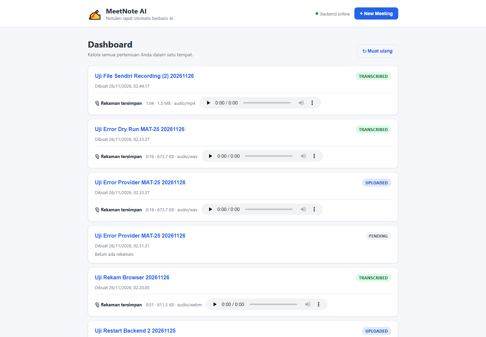
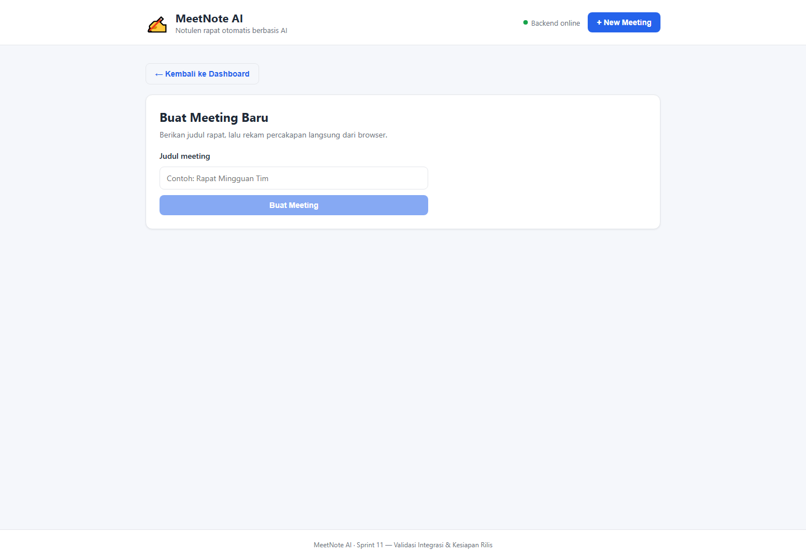
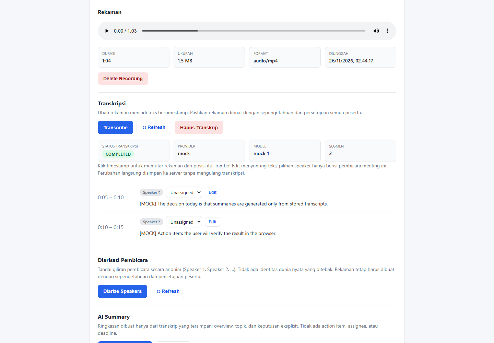
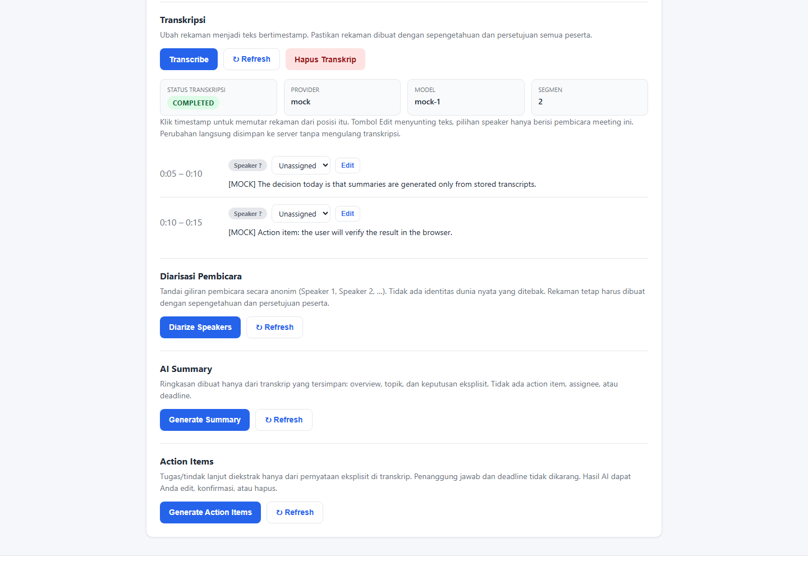
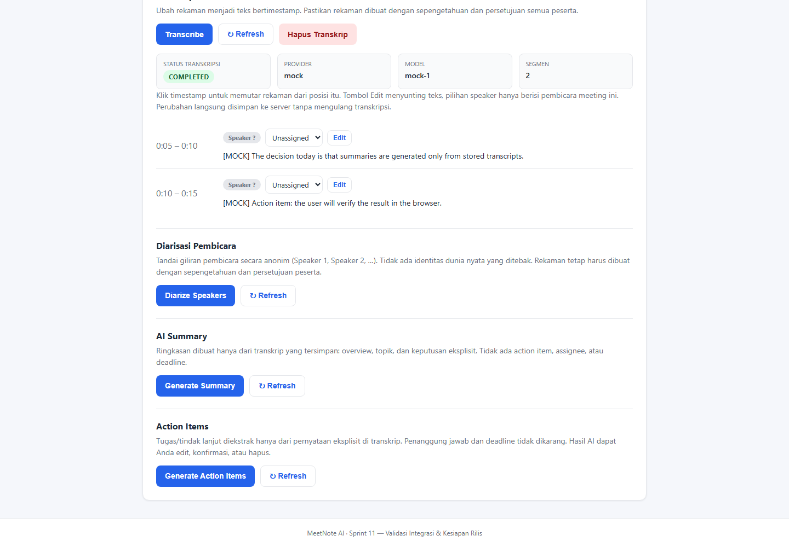
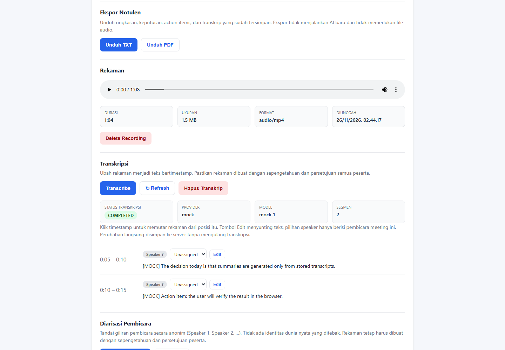
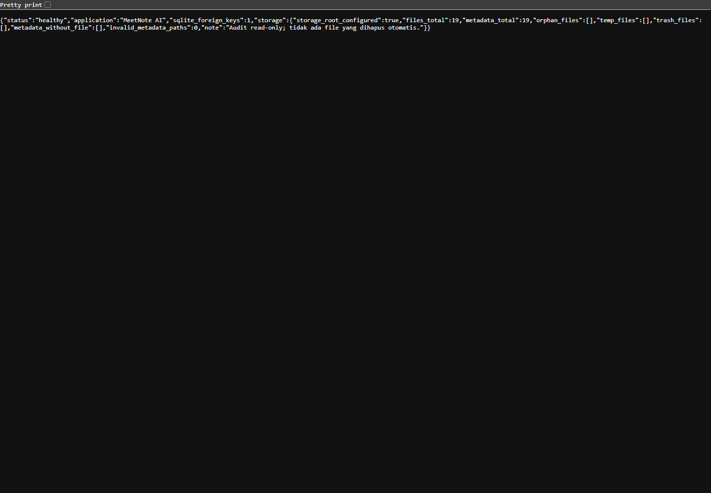

# MeetNote AI

Aplikasi web untuk merekam atau mengunggah percakapan, mentranskripsikan
pembicaraan, mengenali pergantian pembicara, dan menghasilkan notulen
menggunakan AI.

> **Status:** Sprint 11 — Validasi Integrasi & Kesiapan Rilis. Pengguna dapat
> merekam/mengunggah audio, mentranskripsikannya, menandai giliran pembicara
> secara anonim (`Speaker 1`, `Speaker 2`, …), menyunting teks segmen, memberi
> nama tampilan speaker buatan sendiri, membuat ringkasan `overview` / `topics` /
> `decisions`, serta mengekstrak dan mengelola action items dari transkrip yang
> tersimpan. Setiap topik, keputusan, dan action item memiliki referensi segmen +
> waktu yang bisa memutar rekaman asli. AI tidak mengarang assignee atau deadline;
> pengguna dapat mengedit, mengubah status, dan menghapus action item. Provider
> cloud (OpenAI/Deepgram) diimplementasikan sesuai dokumentasi resmi tetapi belum
> diuji live (tanpa API key); seluruh test otomatis memakai provider mock `[MOCK]`.
> Sprint 9 menambah pengaman konkurensi job, foreign key SQLite, recovery
> idempoten, audit storage read-only, dan logging aman tanpa mengubah fitur.
> Sprint 10 menambah tombol **Unduh TXT**/**Unduh PDF** yang merangkum data yang
> sudah tersimpan — tanpa AI baru, tanpa akses audio, tanpa file sementara, dan
> tanpa mengubah database. Sprint 11 memvalidasi integrasi Sprint 1–10 dengan
> 7 test backend baru, memperbaiki polling frontend/default rilis/CORS, dan
> mendokumentasikan kesiapan deployment. Sprint 12 mengaudit repository dan
> dependency, menambahkan panduan instalasi/backup-restore/manual acceptance,
> serta mengonfirmasi regresi 229 test backend + 7 test frontend dan build sukses.
> Sprint 13 mengaudit sebelum Git, menyajikan rencana inisialisasi tanpa
> mengeksekusinya, membuktikan 3 skenario acceptance otomatis dengan DB/storage
> test, dan mengonfirmasi ulang regresi 229 + 7 + build sukses. Lanjutan Phase A/B
> 24–26 Nov menyelesaikan manual acceptance: **PASS 26 / FAIL 0 / BLOCKED 0 /
> NOT TESTED 0**, termasuk MAT-25 lewat kegagalan mock terkontrol; bukti ada di
> `docs/MANUAL_ACCEPTANCE_TEST.md` dan `docs/SPRINT13.md`. Repository kini sudah
> diinisialisasi dan kode pertama telah di-push ke GitHub. Rilis lokal/internal
> secara teknis siap; deployment publik masih memerlukan autentikasi dan
> konkurensi antar-proses.

## Tentang proyek

MeetNote AI adalah aplikasi web lokal/internal untuk membantu rapat: pengguna
dapat merekam langsung dari mikrofon browser atau mengunggah berkas audio,
mendapat transkrip bersegmen dengan penanda waktu, mengenali giliran pembicara
secara anonim (`Speaker 1`, `Speaker 2`, …), menyunting transkrip, membuat
ringkasan dan action item, lalu mengunduh notulen dalam format TXT atau PDF.

Selama acceptance, seluruh hasil AI berasal dari **provider mock** dan diberi
awalan `[MOCK]`. Tidak ada API key atau penyedia cloud yang dipakai. Ini
dirancang supaya alur aplikasi bisa diverifikasi end-to-end tanpa kredensial;
provider live dapat dipasang kemudian sebagai pengganti mock.

Bukti tertulis lengkap ada di:

- `docs/MANUAL_ACCEPTANCE_TEST.md` — checklist MAT-01–MAT-26 dan ringkasan akhir.
- `docs/SPRINT13.md` — bukti API/UI per skenario, termasuk lampiran 5.1w untuk
  unggah berkas audio milik pengguna.
- `docs/ARCHITECTURE.md` — batasan arsitektur dan status rilis.

## Bukti visual

Tangkapan layar berikut diambil sungguhan dari aplikasi yang berjalan di
`http://localhost:5173` memakai Chrome headless (1440×1000), bukan gambar yang
digenerate. Berkas disimpan di `docs/screenshots/`.

| Bukti | Tampilan | Gambar |
| --- | --- | --- |
| Dashboard | Daftar meeting dan status koneksi backend |  |
| New Meeting | Form **Buat Meeting Baru** |  |
| Rekaman | Panel **Rekaman** pada detail meeting: berkas tersimpan, durasi, ukuran |  |
| Transkrip | Dua segmen `[MOCK]` dengan penanda waktu |  |
| Ringkasan | AI Summary dan action item |  |
| Ekspor | Panel **Unduh TXT** / **Unduh PDF** |  |
| Diagnostics | Respons API `/health/diagnostics` — 19 file / 19 metadata, 0 orphan |  |

`docs/screenshots/07-error.png` sengaja tidak dibuat: tidak ada meeting
berstatus `FAILED` di DB test saat SS diambil, jadi gambar itu tidak akan
benar-benar menampilkan pesan error. Bukti MAT-25 tetap ada di
`docs/MANUAL_ACCEPTANCE_TEST.md` dan `docs/SPRINT13.md`.

Catatan: Chrome headless tidak dapat mereproduksi izin mikrofon maupun klik
Pause/Resume secara interaktif. SS `03-recording.png` menunjukkan **hasil**
rekaman yang sudah tersimpan, bukan indikator `recording`/`paused` secara live.

## Teknologi

**Backend**
- Python 3.12
- FastAPI
- SQLAlchemy (SQLite)
- Pydantic / Pydantic Settings
- httpx (HTTP client untuk provider STT & diarisasi)
- reportlab (generator PDF; font TTF dibundling dalam paket)
- pytest + pypdf (parser PDF untuk test)

**Frontend**
- React
- Vite
- TypeScript
- npm
- MediaRecorder API + HTMLAudioElement (browser)
- Drag-and-drop API (browser)

## Struktur proyek

```text
meetnote-ai/
├── backend/
│   ├── app/
│   │   ├── api/v1/        # health, config, meetings, recordings, transcriptions,
│   │   │                  # diarizations, transcript_edits, summaries, action_items,
│   │   │                  # export (TXT/PDF)
│   │   ├── core/          # config, audio, storage helpers
│   │   ├── models/        # Meeting, AudioAsset, TranscriptSegment, Speaker, jobs,
│   │   │                  # summary, action_item
│   │   ├── schemas/       # Pydantic request/response
│   │   ├── database/      # engine, session, migrasi aditif
│   │   ├── services/      # workflow + stt/ + diarization/ + llm/ + summary/
│   │   │                  # + action_items/ + export.py
│   │   └── main.py        # entry point FastAPI
│   ├── tests/             # pengujian Sprint 1 s/d 10
│   ├── .env.example
│   ├── requirements.txt
│   └── main.py
├── frontend/
│   ├── src/
│   │   ├── api.ts         # semua pemanggilan backend
│   │   ├── hooks/         # useMediaRecorder, useAudioFile
│   │   ├── components/    # NewMeeting, AudioUploader, MeetingList,
│   │   │                  # MeetingDetail, TranscriptEditor,
│   │   │                  # TranscriptSegmentItem, SpeakerManager, StatusBadge
│   │   ├── utils/         # format + export (helper unduh/notulen)
│   │   ├── types.ts
│   │   └── ...
│   ├── tests/             # node:test helper export (tanpa dependency baru)
│   └── .env.example
├── docs/
├── storage/               # audio hasil rekaman/upload (auto dibuat per meeting)
├── .env.example
├── .gitignore
└── README.md
```

## Persyaratan instalasi

- Python 3.12 (https://www.python.org/downloads/)
- Node.js 24.x dengan npm 11.x (terverifikasi 24.22.1 / 11.19.1) (https://nodejs.org/)
- Browser modern dengan dukungan `MediaRecorder` (Chrome/Edge/Firefox/Safari terbaru)
- Mikrofon yang terhubung (hanya untuk rekaman langsung)

Disarankan menggunakan virtual environment Python.

## Cara menjalankan backend (Windows PowerShell)

Dari root proyek:

```powershell
cd backend
py -3.12 -m venv .venv
.\.venv\Scripts\Activate.ps1
pip install -r requirements.txt
Copy-Item .env.example .env
python main.py
```

Untuk Sprint 4–5, 7, dan 8, isi variabel `STT_*`, `DIARIZATION_*`, dan `LLM_*` di
`backend/.env` jika ingin memakai provider sungguhan. Tanpa itu, transkripsi/
diarisasi/ringkasan/ekstraksi action items ditolak dengan pesan konfigurasi;
untuk mencoba alur UI tanpa API key, set `STT_PROVIDER=mock`,
`DIARIZATION_PROVIDER=mock`, dan `LLM_PROVIDER=mock` (hasil akan ditandai
`[MOCK]`). Action items memakai provider LLM yang SAMA dengan ringkasan — tidak
ada provider AI baru dan tidak ada variabel `ACTION_*` baru. Lihat
`docs/SPRINT4.md`, `docs/SPRINT5.md`, `docs/SPRINT7.md` bagian 3 dan 5, serta
`docs/SPRINT8.md` bagian 3 dan 10.

Alternatif dengan uvicorn:

```powershell
uvicorn app.main:app --reload --port 8000
```

Jika aktivasi virtual environment diblokir, jangan mengubah Execution Policy.
Jalankan langsung dengan python dari venv:

```powershell
.\.venv\Scripts\python.exe main.py
```

Backend berjalan di `http://localhost:8000`.
- Dokumentasi interaktif: `http://localhost:8000/docs`
- Health check: `http://localhost:8000/api/v1/health`
- Diagnostik read-only (FK + audit storage):
  `http://localhost:8000/api/v1/health/diagnostics`
- Konfigurasi audio: `http://localhost:8000/api/v1/config`

Database SQLite (`meetnote.db`) dibuat otomatis di folder `backend/` saat
aplikasi pertama kali dijalankan. Tabel `audio_assets` (Sprint 3),
`transcript_segments` + `transcription_jobs` (Sprint 4), `speakers` +
`diarization_jobs` (Sprint 5), `meeting_summaries` + `summary_jobs`
(Sprint 7), dan `action_items` + `action_item_sources` + `action_item_jobs`
(Sprint 8) dibuat otomatis. Sprint 5 juga menambah kolom
`transcript_segments.speaker_id` secara idempoten bila database lama belum
memilikinya. Sprint 9 menambah kolom `run_token` pada keempat tabel job dan
unique index `audio_assets.meeting_id` (hanya bila data lama tidak duplikat),
serta mengaktifkan `PRAGMA foreign_keys=ON` untuk SQLite pada setiap koneksi.
Tabel lama tidak dijatuhkan atau dibuat ulang; tidak ada Alembic. Detail ada di
`docs/SPRINT9.md`.

## Cara menjalankan frontend

Terminal terpisah, dari root proyek:

```powershell
cd frontend
npm install
Copy-Item .env.example .env
npm run dev
```

Frontend berjalan di `http://localhost:5173`.
Nilai `VITE_API_BASE_URL` di `frontend/.env` harus mengarah ke backend
(default: `http://localhost:8000`).

Build produksi:

```powershell
npm run build
```

Hasil build ada di `frontend/dist/`.

## Cara memberikan izin mikrofon

1. Buka `http://localhost:5173` di browser (localhost dianggap aman oleh browser).
2. Saat menekan **Start Recording**, browser akan menampilkan prompt izin mikrofon.
   Pilih **Allow / Izinkan**.
3. Jika terlanjur ditolak:
   - Chrome/Edge: klik ikon gembok di address bar → izinkan Mikrofon, atau buka
     `chrome://settings/content/microphone`.
   - Firefox: klik ikon perisai di address bar → izinkan Mikrofon.
4. Pastikan tidak ada aplikasi lain yang memakai mikrofon secara eksklusif.

Tidak perlu mengubah pengaturan sistem Windows atau PowerShell.

## Cara merekam atau mengunggah audio

Buat meeting terlebih dahulu: klik **+ New Meeting**, isi judul, klik
**Buat Meeting**. Lalu pilih **salah satu** cara — satu meeting hanya menyimpan
satu rekaman (`AudioAsset`).

### Opsi 1 — Rekam langsung (MediaRecorder)

1. Klik **Start Recording**. Indikator merah dan durasi akan muncul.
2. Opsional: **Pause** lalu **Resume** (jika browser mendukung).
3. Klik **Stop Recording** setelah selesai.
4. Dengarkan di preview, lalu klik **Save Recording** (atau **Hapus Rekaman**
   untuk membuang rekaman sementara, ada konfirmasi).

### Opsi 2 — Unggah file audio lokal

1. Klik **Choose Audio File** atau tarik (drag) file ke area dropzone.
2. File **tidak** otomatis terunggah. UI menampilkan nama file, ukuran, durasi
   (jika browser bisa membacanya), dan audio preview.
3. Klik **Upload Audio** untuk menyimpan ke server, atau **Remove** untuk
   membatalkan pilihan.
4. Indikator "Mengunggah…" muncul saat proses berlangsung; pesan sukses/error
   ditampilkan dengan jelas.

Frontend melakukan pemeriksaan awal (ekstensi, MIME, ukuran) memakai
konfigurasi dari `GET /api/v1/config`. Backend tetap menjadi sumber validasi
utama. Binary audio tidak pernah disimpan di `localStorage`.

Setelah berhasil, halaman detail menampilkan status `UPLOADED`, durasi, ukuran
file, dan player audio. Kembali ke dashboard untuk melihat daftar meeting.

## Cara menghapus/ganti rekaman

1. Buka detail meeting yang memiliki rekaman (klik judul di dashboard).
2. Klik **Delete Recording**, lalu konfirmasi pada dialog browser.
3. Metadata dan file audio dihapus; status meeting kembali ke `PENDING`.
4. Klik **+ Tambah Rekaman** untuk merekam ulang atau mengunggah file baru.

## Cara mentranskripsikan rekaman

1. Buka detail meeting yang memiliki rekaman. Rekaman harus dibuat dengan
   sepengetahuan dan persetujuan semua peserta.
2. Klik **Transcribe**. Backend langsung memvalidasi meeting, file audio,
   format, ukuran, dan konfigurasi provider.
3. Status **Memproses…** muncul; halaman otomatis menyegarkan status selama
   job background berjalan. Tombol **↻ Refresh** bisa dipakai kapan saja.
4. Setelah selesai, daftar segmen + timestamp tampil pada halaman yang sama.
   Bila provider hanya mengembalikan teks, UI menampilkan “Tanpa timestamp
   asli”, bukan angka rekaan.
5. Klik **Hapus Transkrip** untuk menghapus teks saja — file rekaman tetap ada.
   Menghapus rekaman juga otomatis menghapus transkrip terkait.

Jika transkripsi gagal, pesan error ditampilkan dan tombol Transcribe bisa
dipakai ulang. Permintaan ganda maupun penghapusan rekaman saat proses masih
berjalan ditolak (`409`).

## Cara mendiarisasi pembicara

1. Selesaikan transkripsi terlebih dahulu. Diarisasi hanya memakai rekaman +
   segmen yang sudah ada; ia tidak mengubah teks atau timestamp.
2. Klik **Diarize Speakers**. Backend memvalidasi audio, format, ukuran,
   konfigurasi provider, dan status transkrip, lalu menjalankan job background.
3. Status **Memproses…** muncul dan di-poll otomatis. Tombol **↻ Refresh**
   tersedia untuk penyegaran manual.
4. Setelah selesai, badge `Speaker 1`, `Speaker 2`, … tampil di samping segmen.
   `Speaker ?` berarti tidak ada overlap yang cukup andal — aplikasi sengaja
   tidak menebak.
5. Bagian Diarisasi menampilkan provider, model, jumlah speaker, dan jumlah
   segmen yang dipetakan. Bila provider mock dipakai, peringatan `[MOCK]`
   ditampilkan.
6. Klik **Hapus Diarisasi** untuk menghapus label + job. Transkrip dan audio
   tetap ada. Permintaan ganda, hapus saat proses berjalan, dan hapus rekaman/
   transkrip saat diarisasi berjalan ditolak (`409`).

Label selalu anonim. Aplikasi tidak menebak identitas dunia nyata. Rekaman,
transkripsi, dan diarisasi tetap harus dilakukan dengan sepengetahuan dan
persetujuan peserta. Detail aturan mapping ada di `docs/SPRINT5.md` bagian 10.

## Cara menyunting transkrip & speaker

Setelah transkrip/diarisasi selesai, bagian **Transkripsi** menampilkan daftar
segmen yang bisa dikoreksi:

1. Klik timestamp (`m:ss`) untuk memindahkan pemutar rekaman ke awal segmen.
   Elemen audio yang sama dipakai kembali — tidak ada unduhan baru. Bila audio
   tidak bisa dimuat, UI menampilkan pesan dan timestamp tetap bisa dibaca.
2. Klik **Edit** pada segmen, ubah teks di textarea, lalu **Save** atau
   **Cancel**. Teks kosong ditolak; batas 10.000 karakter per segmen. Hanya teks
   yang berubah — timestamp, urutan, dan speaker tidak tersentuh.
3. Gunakan pilihan speaker di setiap segmen untuk memilih **Unassigned** atau
   pembicara meeting ini. Perubahan langsung tersimpan dan badge ikut berubah.

Pada bagian **Diarisasi Pembicara**, klik **Edit Nama** untuk memberi nama
tampilan pada `Speaker 1`, `Speaker 2`, … (maksimal 255 karakter). **Pakai label**
menghapus nama dan kembali ke label anonim. Nama ini murni catatan pengguna,
bukan identitas yang ditebak dari suara; label `Speaker N` sendiri tidak bisa
diubah.

Semua perubahan langsung ditulis ke SQLite dan tetap ada setelah refresh.
Tidak ada transkripsi ulang dan tidak ada AI yang menulis ulang teks. Edit
ditolak (`409`) saat transkripsi/diarisasi masih berjalan. Detail lengkap ada
di `docs/SPRINT6.md` bagian 6–10.

## Cara membuat ringkasan AI

1. Selesaikan transkripsi terlebih dahulu. Ringkasan hanya membaca segmen yang
   sudah tersimpan; tidak merekam, mentranskripsi, atau memanggil audio baru.
2. Klik **Generate Summary** pada bagian **AI Summary**. Untuk mengulang, klik
   **Regenerate Summary**. Permintaan ganda atau saat STT/diarisasi masih
   berjalan ditolak (`409`).
3. Status job di-poll otomatis. Tombol **↻ Refresh** menyegarkan status secara
   manual; `202` berarti job diterima, bukan berarti hasil sudah jadi.
4. Setelah selesai, halaman menampilkan **Overview**, **Topics**, dan
   **Decisions**. Tombol waktu di samping setiap topik/keputusan memutar cuplikan
   dari rekaman asli memakai player yang sama (tanpa unduhan baru).
5. Nama pembicara mengikuti `display_name` buatan pengguna bila ada, jika tidak
   maka label anonim seperti `Speaker 1`. Teks ringkasan mengikuti bahasa
   transkrip kecuali `LLM_OUTPUT_LANGUAGE` diisi di backend.
6. Klik **Hapus Ringkasan** untuk menghapus ringkasan + job; transkrip, speaker,
   dan audio tetap ada. Jika regenerasi gagal, ringkasan lama sengaja dipertahankan
   dan job ditandai `FAILED`.

Sprint 7 **tidak** mengekstrak action item, assignee, atau deadline. Keputusan
hanya dicatat bila dinyatakan eksplisit; usulan atau diskusi tidak diubah menjadi
keputusan. Jika tidak ada keputusan eksplisit, daftar `Decisions` kosong. Detail
lengkap ada di `docs/SPRINT7.md`.

## Cara mengelola action items

1. Selesaikan transkripsi. Action items hanya dibaca dari segmen yang tersimpan
   dan memakai provider LLM yang sama dengan ringkasan (`LLM_*`).
2. Klik **Generate Action Items** pada bagian **Action Items**. Untuk mengulang,
   klik **Regenerate Action Items**. Permintaan ganda atau saat STT/diarisasi
   berjalan ditolak (`409`); `202` berarti job diterima, bukan hasil jadi.
3. Status di-poll otomatis; **↻ Refresh** menyegarkan manual. Setelah selesai,
   tampil judul, deskripsi, penanggung jawab, deadline, status
   `OPEN`/`COMPLETED`/`CANCELLED`, dan tombol waktu sumber yang memutar cuplikan
   pada audio player yang sama (tanpa unduhan baru).
4. Klik **Edit** untuk mengubah judul, deskripsi, penanggung jawab (speaker
   meeting ini atau teks eksplisit), frasa deadline, tanggal, dan status.
   Tombol **✓ Selesai**, **Batalkan**, dan **Buka lagi** mengubah status cepat.
5. **Hapus** menghapus satu item; **Hapus Semua Action Items** menghapus seluruh
   hasil + job dengan konfirmasi. Transkrip, speaker, dan audio tetap ada.
6. Regenerasi mengganti hanya item hasil AI yang belum disunting. Item yang
   pernah Anda edit (`✎ diedit manual`) tidak ditimpa atau dihapus. Jika
   regenerasi gagal, action items lama tetap utuh dan job berstatus `FAILED`.

AI hanya menetapkan penanggung jawab bila pernyataan eksplisit mendukungnya,
dan hanya mengisi tanggal bila tidak ambigu. Detail lengkap ada di
`docs/SPRINT8.md`.

## Cara mengekspor notulen

1. Buka detail meeting. Bagian **Ekspor Notulen** tersedia walau meeting belum
   punya rekaman.
2. Klik **Unduh TXT** atau **Unduh PDF**. Nama file dibuat backend, misalnya
   `notulen-rapat-rilis.txt` / `notulen-rapat-rilis.pdf`.
3. Selama proses berjalan, tombol dinonaktifkan dan label berubah menjadi
   **Menyiapkan…**; klik berikutnya diabaikan. Jika gagal, pesan error muncul di
   bawah tombol.
4. Isi dokumen: informasi rapat, pembicara (nama tampilan bila ada), ringkasan
   eksekutif, topik, keputusan, action items (judul, deskripsi, penanggung jawab,
   deadline, status, sumber, penanda edit manual), dan lampiran transkrip
   berurutan dengan timestamp. PDF memakai halaman A4, header/footer, nomor
   halaman, tabel action item, dan lampiran transkrip di halaman terpisah.

Ekspor **hanya membaca** data yang sudah tersimpan. Ia tidak menjalankan AI,
tidak membuka file audio, tidak menulis/menghapus data, dan tidak membuat file
sementara di server. Bagian yang belum tersedia ditandai `Belum tersedia.`
beserta status job (`NOT_STARTED`/`PROCESSING`/`COMPLETED`/`FAILED`). Detail
lengkap ada di `docs/SPRINT10.md`.

## Format audio yang diterima

| Format | MIME | Ekstensi input | Nama file internal |
| --- | --- | --- | --- |
| WebM | `audio/webm` | `.webm` | `.webm` |
| OGG | `audio/ogg` | `.ogg` | `.ogg` |
| WAV | `audio/wav`, `audio/x-wav` | `.wav` | `.wav` |
| MP3 | `audio/mpeg` | `.mp3` | `.mp3` |
| M4A / MP4 | `audio/mp4`, `audio/x-m4a` | `.m4a`, `.mp4` | `.m4a` |

Untuk rekaman langsung, frontend memilih format pertama yang didukung
`MediaRecorder.isTypeSupported()`:

1. `audio/webm;codecs=opus` (Chrome/Edge) → `.webm`
2. `audio/ogg;codecs=opus` (Firefox) → `.ogg`
3. `audio/mp4` (Safari modern) → `.m4a`
4. `audio/wav` → `.wav`

Parameter `;codecs=...` dibuang sebelum divalidasi. Batas ukuran default
**25 MB** per file (`MAX_AUDIO_FILE_BYTES=26214400`).

Validasi konten hanya berupa signature sederhana (EBML, OggS, RIFF/WAVE, ID3,
MPEG frame, ftyp). File dengan signature tidak dikenali tetap diterima untuk
kompatibilitas dengan payload MediaRecorder; ini **bukan** jaminan bahwa isi
file benar-benar audio. Lihat `docs/SPRINT3.md`.

## Penyimpanan audio

- File audio: `storage/meetings/{meeting_id}/recording-{uuid}.{ext}`
- Metadata audio: tabel SQLite `audio_assets` di `backend/meetnote.db`
- Transkrip: tabel `transcript_segments` + status `transcription_jobs` di
  database yang sama; binary audio tetap tidak masuk database
- Diarisasi: tabel `speakers` + status `diarization_jobs`; segmen memakai
  `speaker_id` opsional yang NULL bila tidak ada mapping andal
- Edit Sprint 6: memakai kolom yang sudah ada (`transcript_segments.text`,
  `.speaker_id`, `speakers.display_name`). **Tidak ada kolom baru** dan tidak ada
  penanda "manual vs otomatis" — lihat `docs/SPRINT6.md` bagian 9.
- Ringkasan Sprint 7: tabel baru `meeting_summaries` dan `summary_jobs` di database
  yang sama; referensi `segment_ids` + waktu disimpan sebagai JSON.
- Action items Sprint 8: tabel baru `action_items`, `action_item_sources` (satu
  baris per segmen dengan foreign key sungguhan), dan `action_item_jobs`. Waktu
  agregat dinormalisasi dari database.
- Export Sprint 10: **tidak ada tabel, kolom, atau file baru**. Hasil dibuat di
  memori dan dikirim sebagai attachment; `storage/` tidak disentuh.
- Nama file dibuat backend, bukan diambil dari nama file browser.
- Frontend tidak pernah menerima path filesystem mentah; ia memakai endpoint
  playback `/api/v1/meetings/{id}/recording/play`.

Direktori dan batas ukuran dapat diubah lewat environment variable:

```dotenv
STORAGE_DIR=../storage
MAX_AUDIO_FILE_BYTES=26214400
STT_PROVIDER=openai
STT_API_KEY=
STT_API_BASE_URL=https://api.openai.com/v1
STT_MODEL=whisper-1
DIARIZATION_PROVIDER=deepgram
DIARIZATION_API_KEY=
DIARIZATION_API_BASE_URL=https://api.deepgram.com/v1
DIARIZATION_MODEL=nova-3
DIARIZATION_DIARIZE_MODEL=latest
LLM_PROVIDER=openai
LLM_API_KEY=
LLM_API_BASE_URL=https://api.openai.com/v1
LLM_MODEL=gpt-4o-mini-2024-08-06
LLM_OUTPUT_LANGUAGE=
LLM_TIMEOUT_SECONDS=90
LLM_MAX_INPUT_CHARACTERS=24000
```

## Endpoint API

| Method | Path | Fungsi |
| --- | --- | --- |
| GET | `/api/v1/health` | Health check |
| GET | `/api/v1/config` | Batas ukuran, format audio, info STT/diarisasi/LLM publik (tanpa API key) |
| GET | `/api/v1/meetings` | Daftar meeting + metadata rekaman |
| POST | `/api/v1/meetings` | Buat meeting (status awal `PENDING`) |
| POST | `/api/v1/meetings/{id}/recording` | Simpan rekaman / upload audio (multipart) |
| GET | `/api/v1/meetings/{id}/recording` | Metadata rekaman |
| GET | `/api/v1/meetings/{id}/recording/play` | Putar file audio (`FileResponse`) |
| DELETE | `/api/v1/meetings/{id}/recording` | Hapus rekaman + file, status → `PENDING` |
| POST | `/api/v1/meetings/{id}/transcription` | Mulai transkripsi background (`202`) |
| GET | `/api/v1/meetings/{id}/transcription` | Status + segmen transkrip |
| DELETE | `/api/v1/meetings/{id}/transcription` | Hapus transkrip saja, audio tetap |
| POST | `/api/v1/meetings/{id}/diarization` | Mulai diarisasi background (`202`) |
| GET | `/api/v1/meetings/{id}/diarization` | Status + speaker anonim |
| DELETE | `/api/v1/meetings/{id}/diarization` | Hapus speaker + job, transkrip/audio tetap |
| PATCH | `/api/v1/meetings/{id}/transcript/{segment_id}` | Sunting teks satu segmen (tanpa STT ulang) |
| PATCH | `/api/v1/meetings/{id}/transcript/{segment_id}/speaker` | Tetapkan speaker satu meeting atau `null` |
| PATCH | `/api/v1/meetings/{id}/speakers/{speaker_id}` | Ubah nama tampilan speaker atau `null` |
| POST | `/api/v1/meetings/{id}/summary` | Generate/retry/regenerate ringkasan background (`202`) |
| GET | `/api/v1/meetings/{id}/summary` | Status + ringkasan terakhir (bisa kosong) |
| DELETE | `/api/v1/meetings/{id}/summary` | Hapus ringkasan + job, transkrip/audio tetap |
| POST | `/api/v1/meetings/{id}/action-items` | Generate/retry/regenerate action items background (`202`) |
| GET | `/api/v1/meetings/{id}/action-items` | Status + action items + opsi speaker |
| DELETE | `/api/v1/meetings/{id}/action-items` | Hapus seluruh action items + job |
| PATCH | `/api/v1/meetings/{id}/action-items/{item_id}` | Edit field/status satu action item |
| DELETE | `/api/v1/meetings/{id}/action-items/{item_id}` | Hapus satu action item |
| GET | `/api/v1/meetings/{id}/export/txt` | Unduh notulen TXT UTF-8 (`attachment`) |
| GET | `/api/v1/meetings/{id}/export/pdf` | Unduh notulen PDF (`attachment`) |

Respons error memakai `detail` dari FastAPI: `400` ekstensi/file kosong atau
teks/nama kosong/terlalu panjang, `404` meeting/rekaman/file/segmen/speaker tidak
ditemukan (termasuk objek dari meeting lain), `409` duplikat rekaman/transkrip/
diarisasi/ringkasan/action items, hapus saat job masih berjalan, atau edit saat
job masih berjalan, `413` ukuran terlalu besar, `415` MIME/format tidak didukung,
`422` field request invalid/field asing/transkrip terlalu panjang/speaker lintas
meeting, `500` kegagalan storage/database
(pesan generik), `502`/`504` kegagalan/timeout provider LLM, `503` konfigurasi
STT/diarisasi/LLM belum lengkap. Error provider saat task background tersimpan
pada field `error` job, bukan dibocorkan mentah.

`POST .../recording` dipakai ulang untuk file lokal Sprint 3 — tidak ada
endpoint upload duplikat. Export mengembalikan `404` bila meeting tidak ada dan
`422` bila UUID tidak valid; kegagalan pembuatan dokumen menjadi `500` generik
tanpa path/internal detail.

## Cara menjalankan test

Backend (Sprint 1 s/d 11):

```powershell
cd backend
python -m pytest -q
```

Hasil terakhir: **229 passed, 1 warning** (222 baseline sebelum Sprint 11 + 7 test
Sprint 11; warning hanya deprecation Starlette/anyio). Test STT/diarisasi/LLM
memakai provider mock dan database/storage isolasi; tidak ada panggilan cloud.
Kontrak Deepgram dan OpenAI diuji dengan HTTP client palsu, bukan request
jaringan. Sprint 7 menambah 27 test; Sprint 8 menambah 43 test; Sprint 9
menambah 15 test; Sprint 10 menambah 12 test; Sprint 11 menambah 7 test integrasi
(E2E penuh, retry/regenerasi, kegagalan provider, transkripsi ulang, job aktif,
konsistensi storage/DB, dan hardening konfigurasi rilis).

Frontend (type-check + build):

```powershell
cd frontend
npm run build
```

Test helper export frontend (7 test, memakai `node:test` bawaan Node.js — tidak
ada dependency baru):

```powershell
cd frontend
npm test
```

Catatan: tidak ada component/DOM test framework; interaksi React diverifikasi
melalui build dan peninjauan kode.

## Keterbatasan browser

- `MediaRecorder` hanya tersedia di secure context: `localhost` atau HTTPS.
- Tidak tersedia di Internet Explorer; dukungan Safari bergantung versi.
- Tombol Pause/Resume hanya muncul jika browser mendukung.
- Durasi file lokal hanya tampil jika browser bisa membaca metadata audio;
  jika tidak, nilai `0` yang dikirim ke backend.
- Izin mikrofon bersifat per-origin; `localhost:5173` berbeda dengan `127.0.0.1:5173`.
- Bukan semua browser bisa memutar semua format; gunakan WebM/Opus atau WAV
  untuk kompatibilitas terbaik.

## Batasan Sprint 7 & 8

Transkripsi, diarisasi, koreksi manual, ringkasan AI, dan action items sudah
tersedia, tetapi:

- ringkasan tetap hanya mencakup `overview`, `topics`, dan `decisions`; action
  items disimpan terpisah, tidak dimasukkan ke `MeetingSummary`;
- ekstraksi bergantung pada kualitas transkrip dan model; AI dapat melewatkan
  tugas yang diucapkan tidak jelas. Validasi backend menjamin referensi valid,
  bukan menjamin interpretasi semantik yang sempurna;
- `due_date` hanya diisi untuk tanggal eksplisit yang tidak ambigu — frasa
  relatif seperti "besok" tetap disimpan apa adanya dengan `due_date` null;
- action items menandai `is_manually_edited` (bukan riwayat edit penuh). Tidak
  ada undo, edit massal, pengingat otomatis, kalender, atau notifikasi email;
- regenerasi mengganti item AI yang belum disunting dan mempertahankan item yang
  pernah diedit — tidak ada pencocokan/merge semantik antar versi;
- menjalankan ulang diarisasi menghapus nama tampilan dan menimpa penugasan
  manual (perilaku Sprint 5 yang dipertahankan);
- nama speaker adalah catatan pengguna, bukan verifikasi identitas dunia nyata;
- transkripsi cloud, diarisasi Deepgram, dan ringkasan OpenAI belum diuji live
  (tidak ada API key saat pengembangan); test otomatis memakai provider mock
  `[MOCK]` dan HTTP client palsu;
- seluruh transkrip dikirim dalam satu request LLM; jika melebihi
  `LLM_MAX_INPUT_CHARACTERS`, ringkasan maupun ekstraksi action items ditolak
  (`422`) — belum ada chunking/map-reduce;
- background task berjalan di proses FastAPI yang sama — job yang tertinggal
  saat restart ditandai `FAILED` dan perlu dicoba ulang;
- tidak ada Redis/Celery/RabbitMQ/Docker/microservice/local LLM;
- belum ada autentikasi, kolaborasi multi-user, PostgreSQL, atau deployment.

Detail lengkap ada di `docs/SPRINT4.md`, `docs/SPRINT5.md`,
`docs/SPRINT6.md`, `docs/SPRINT7.md`, dan `docs/SPRINT8.md`.

## Batasan Sprint 10

- Export adalah snapshot saat request; tidak ada pilihan sebagian bagian,
  watermarks, tanda tangan digital, atau bahasa dokumen selain Indonesia.
- PDF memakai font Bitstream Vera yang dibundling reportlab: karakter di luar
  Latin Extended (mis. CJK/emoji) diganti `?`. Berkas TXT tetap mempertahankan
  Unicode apa adanya.
- Teks sangat panjang dibungkus otomatis di tabel/paragraf PDF; tidak ada
  penyesuaian tipografi tingkat lanjut.
- Test frontend hanya helper murni (`node:test`); tidak ada automation browser.
- `reportlab` dan `pypdf` menambah dependency backend (keduanya pure-Python).
  Detail dan alasan lengkap ada di `docs/SPRINT10.md`.

## Batasan Sprint 11

- Rilis lokal/internal siap, tetapi **belum** untuk deployment publik/multi-user:
  tidak ada autentikasi/otorisasi dan job lock hanya berlaku dalam satu proses.
- Tidak ada retry/backoff otomatis untuk 429/5xx; pengguna harus menekan tombol
  coba ulang. Job gagal tidak pernah dilaporkan `COMPLETED` palsu.
- Provider cloud belum diuji dengan API key sungguhan; smoke test manual masih
  diperlukan.
- Tidak ada automation browser untuk desktop/tablet/mobile; interaksi React
  diverifikasi lewat build, peninjauan kode, dan checklist manual.
- Default rilis sekarang `DEBUG=false` dan CORS dibatasi
  `CORS_ALLOWED_ORIGINS`; set keduanya di `.env` bila menyajikan frontend dari
  origin lain.
- Detail temuan, status `FIXED`/`ACCEPTED RISK`/`DEFERRED`, dan bukti lengkap ada
  di `docs/SPRINT11.md`.

## Batasan Sprint 12

- Proyek **bukan** repository Git. Tidak ada `.git` di root/parent; tidak ada
  remote. Inisialisasi Git hanya rekomendasi dan menunggu persetujuan.
- `package-lock.json` sudah ada dan sinkron; `npm ci` dianjurkan, `npm update`
  tidak dijalankan.
- Manual acceptance testing belum dijalankan. Checklist 26 skenario ada di
  `docs/MANUAL_ACCEPTANCE_TEST.md` dengan status awal `NOT TESTED`.
- Pengujian live provider tidak dilakukan. Checklist error provider memakai
  skenario gagal terkontrol/mock sampai ada kredensial dan persetujuan.
- Rilis lokal/internal siap; public release **belum** karena auth dan konkurensi
  antar-proses masih menjadi prasyarat.
- Detail audit, packaging, dan hasil test ada di `docs/SPRINT12.md`.
- Sprint 13: repository tetap belum diinisialisasi karena persetujuan Git write
  ditolak. MAT-02/MAT-03/MAT-26 lulus dengan DB/storage test; pada akhir sprint
  MAT-25 `BLOCKED` dan 22 skenario lain `NOT TESTED`. Lanjutan Phase A/B 24–26 Nov
  menyelesaikan seluruh 26 skenario (PASS 26); detail ada di `docs/SPRINT13.md`.

## Keamanan

- File `.env` dan database tidak ikut ke Git (lihat `.gitignore`).
- `STT_API_KEY`, `DIARIZATION_API_KEY`, dan `LLM_API_KEY` hanya dibaca di backend
  sebagai `SecretStr`; tidak ada variabel `VITE_STT_*`/`VITE_DIARIZATION_*`/
  `VITE_LLM_*`, dan `GET /api/v1/config` hanya mengembalikan nama provider + status
  konfigurasi. Prompt, header Authorization, dan response mentah tidak pernah
  dikirim ke frontend atau ditulis ke log.
- Nama file pengguna tidak dipakai sebagai path; semua path divalidasi tetap
  berada di dalam `STORAGE_DIR` (termasuk saat `DELETE`).
- File audio tidak bisa diakses lewat URL filesystem mentah.
- Nama file internal generated UUID; penulisan memakai file `.part` lalu
  `os.replace`, penghapusan memakai file `.delete` dengan rollback saat commit gagal.
- Validasi format saat ini mencakup MIME, ekstensi, ukuran, dan signature
  sederhana — bukan pemeriksaan konten audio yang sempurna.
- Export tidak memakai path filesystem pengguna: nama file dihasilkan dari slug
  ASCII judul meeting, UUID divalidasi, dan exception tidak pernah dikirim ke
  klien maupun ditulis dengan pesan aslinya ke log. Hasil dibuat di memori, jadi
  tidak ada file export yang tersimpan di server.

## Dokumentasi

Daftar lengkap ada di `docs/README.md`: `SPRINT1.md`–`SPRINT13.md`,
`ARCHITECTURE.md`, `INSTALLATION.md`, `BACKUP_RESTORE.md`, dan
`MANUAL_ACCEPTANCE_TEST.md`. Detail Sprint 13 ada di `docs/SPRINT13.md`.
